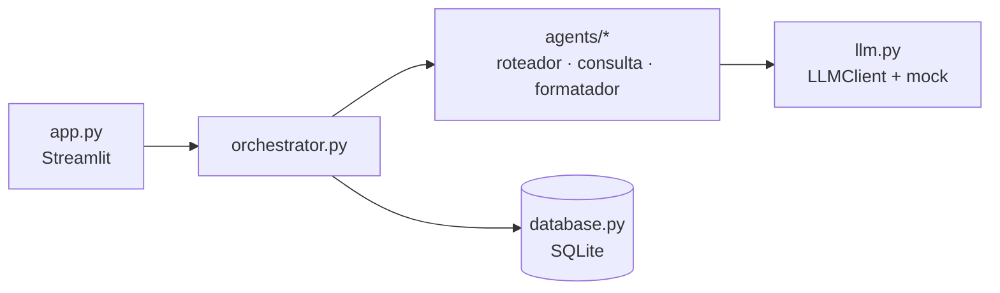

# edu-agent-orchestrator

Assistente educacional de álgebra para um cursinho popular, construído como PoC de portfólio com arquitetura **multi-agente** em Python, Streamlit e SQLite. O objetivo é **demonstrar desenho de arquitetura e separação de camadas**, não evoluir um produto.

O aluno pergunta em linguagem natural ("exercícios de equação do 2º grau", "resumo de fatoração", "resolução de sistemas lineares") e recebe a resposta em Markdown com LaTeX, montada a partir de dados reais do banco. Um expander mostra **como a resposta foi gerada** (intenção, SQL, tentativas, avisos e tempos).

## Arquitetura

```
app.py  ──►  orchestrator.py  ──►  agents/*  ──►  llm.py
                    │
                    └──────────►  database.py
```



Fluxo de uma pergunta: roteador (classifica a intenção) → agente de consulta (gera o SQL) → banco (valida e executa somente leitura) → formatador (Markdown + LaTeX a partir das linhas reais) → validação de LaTeX.

### Regra de dependência

- `app.py` importa **só** `orchestrator` e `models` (além do `streamlit`). Nunca `database`, `agents` ou `llm`.
- `agents/` importa apenas `llm`, `models` e `exceptions`. **Nunca** `database`.
- `database.py` não conhece agentes nem LLM.
- Só o orquestrador enxerga agentes e banco juntos.

Essas fronteiras são verificadas por `tests/test_architecture.py`, que lê os imports de cada arquivo com `ast` e falha se alguma for violada.

### Retry com correção

Camadas inferiores levantam exceções tipadas; só o orquestrador as captura e traduz em `status` (`ok`, `fora_do_escopo`, `sem_resultados`, `erro`). Quando o SQL gerado é rejeitado pelo validador, falha no SQLite ou vem em formato inválido, o orquestrador chama o agente de consulta de novo, informando o SQL anterior e o erro, até **3 tentativas** no total. Cada tentativa aparece no expander.

## Como rodar

```bash
pip install -r requirements-dev.txt # runtime (streamlit, pydantic) + pytest; só rodar a demo exige apenas requirements.txt
streamlit run app.py                # demo em http://localhost:8501
pytest                              # suíte de testes
```

O banco `data/edu.db` (dentro da pasta do projeto, qualquer que seja o diretório de onde o app é iniciado) é criado e populado automaticamente na primeira execução.

## Exemplos de perguntas

- `exercícios de equação do 2º grau`
- `resumo de fatoração`
- `resolução de sistema linear`
- `teste retry exercícios de fatoração`: o mock devolve um SQL inválido na primeira tentativa e o correto na segunda, então o expander mostra **2 tentativas** (a primeira com o erro).
- `exercícios de logaritmo`: tópico fora do seed, o SQL não encontra linhas e a resposta é `sem_resultados` (o formatador nem é chamado).
- `capital da França`: fora do escopo, o assistente explica o que sabe responder.

## Como trocar o mock por um LLM real

Os agentes recebem um `LLMClient` (um `Protocol` com `complete(system, user) -> str`) no construtor. Hoje só existe o `MockLLMClient`, determinístico e por palavras-chave. Para usar um LLM real:

1. Crie uma classe que implemente `LLMClient` (por exemplo, `AnthropicLLMClient` em `llm.py` ou em um módulo novo, chamando o SDK do provedor).
2. Troque **uma linha** em `build_orchestrator()` (`orchestrator.py`): `llm = MockLLMClient()` passa a instanciar a nova classe.

Nada mais muda: o SQL vindo do LLM continua passando pelo validador e pela conexão somente leitura de `database.py`.

## Limite conhecido

O orquestrador é **stateless**: `handle(texto)` não recebe o histórico da conversa, então o assistente não tem memória entre mensagens (o histórico em `st.session_state` serve só para redesenhar o chat). Para suportar follow-ups como "e a resolução desse?", o contrato passaria a ser `handle(texto, historico)`.
